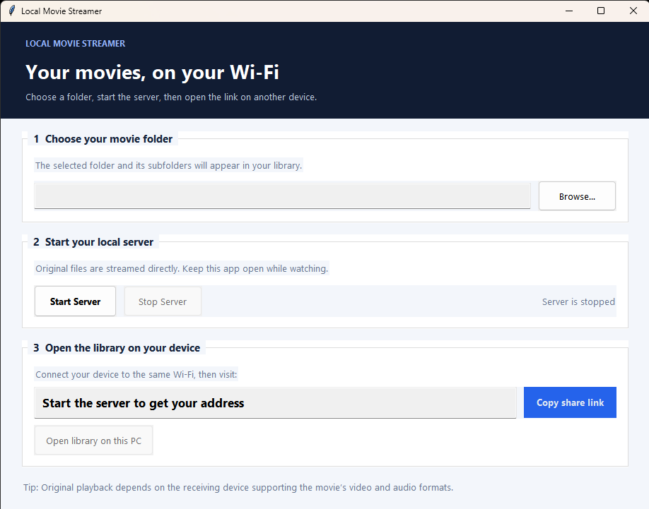

# Home Stream

Watch movies stored on your Windows PC from a phone, tablet, or another computer on the same Wi-Fi network.

## Download for Windows

[**Download Home Stream**](https://github.com/Abrar-Reshad/Home_Stream/raw/refs/heads/main/dist/LocalMovieStreamer.exe)

The download is a single Windows app. You do not need to install Python or FFmpeg.

## How to use the app

1. Download `LocalMovieStreamer.exe` using the link above and open it on the PC that has your movies.
2. In **Choose your movie folder**, click **Browse…** and select the folder containing your video files. Videos in its subfolders will also appear.
3. Click **Start Server**.
4. Connect your phone, tablet, or other computer to the **same Wi-Fi network** as the PC.
5. Click **Copy share link** in the app. Open a browser on the other device and paste the link into its address bar.
6. Choose a movie from the library to play it. Keep Home Stream running while watching. Click **Stop Server** when finished.

If Windows Firewall asks, allow the app on **Private networks** so your devices can connect.

## Playback compatibility

Home Stream sends each video in its original format without converting it. The browser and device you watch on need to support that file’s video and audio formats. If a movie does not play, try another browser or device, or make a compatible copy such as MP4 with H.264 video and AAC audio.

Supported file extensions: `.mp4`, `.m4v`, `.webm`, `.mov`, `.mkv`, and `.avi`.
